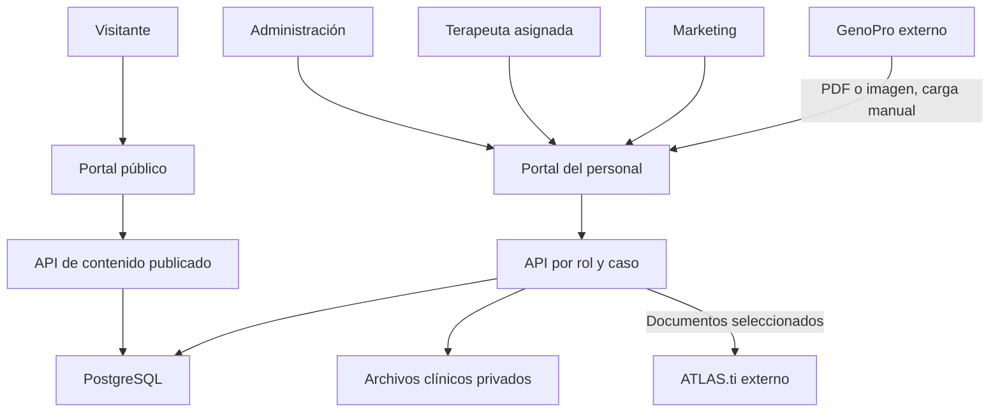

# FE-195 · Contratos funcionales y trazabilidad del Sprint 3

**Responsable:** Andrea Carolina Narváez Ortega.

**Fecha:** 23/11/2026.

**Base revisada:** `main` en `37ed16bcca9bb3d6842c62f41b58a1bf17f7616f`.

**Naturaleza:** adenda de análisis y arquitectura propuesta. No certifica funciones implementadas ni ratificación de la Fundación.

## 1. Qué hacer primero

1. Entregar FE-188 y FE-123: reglas de consentimiento/pagos y ficha/fuente clínica.
2. Entregar FE-134 y FE-140: residencia y difusión; el equipo puede preparar modelos y contratos.
3. Continuar con genograma, informes, exportación, importación e investigación.
4. Implementar el registro sencillo de gastos de FE-172; la planificación de personal FE-4 está retirada. El alcance del foro sigue pendiente de ratificación.
5. Con contratos revisados, implementar los componentes de Andrea FE-124, FE-146 y la parte frontend de FE-162.
6. La aceptación de logout FE-194, la aceptación integrada FE-196 y los eventos FE-205 requieren evidencia real posterior.

Todos los archivos de este directorio son análisis preparado. Cuando una regla dice “propuesta” o “pendiente”, no debe presentarse como autorización de la contraparte. El equipo puede avanzar con estructuras, prototipos y pruebas ficticias dejando visibles esas decisiones.

## 2. Entregables por subtarea

| Tarea | Documento | Equipo que recibe | Pendiente principal de cierre |
|---|---|---|---|
| FE-188 | [Decisiones de consentimiento y pagos](FE-188-decisiones-consentimiento-pagos.md) | Adriana, Jorge y Emilia | Ratificar política de consentimiento y pagos. |
| FE-123 | [Ficha familiar y diagnóstico vigente](FE-123-ficha-familiar-y-diagnostico.md) | Alejandro, Adriana, Jorge y Emilia | Validar ficha de referencia y mínimo clínico. |
| FE-134 | [Residencia, filtros y conteos de aceptación](FE-134-residencia-y-filtros.md) | Alejandro, Adriana, Gemina, Jorge y Emilia | Confirmar necesidad de residencia histórica y otra localidad. |
| FE-140 | [Campos, estados y permisos de difusión](FE-140-difusion-publicaciones.md) | Gemina, Alejandro, Adriana, Jorge y Emilia | Completar contenido/contactos autorizados de FE-141. |
| FE-129 | [Importación visual de GenoPro](FE-129-importacion-genopro.md) | Alejandro, Adriana, Jorge y Emilia | Versión y muestra ficticia exportada desde GenoPro. |
| FE-151 | [Plantillas de informes y mapeo clínico](FE-151-plantillas-informes.md) | Alejandro, Adriana, Jorge y Emilia | Validar las dos plantillas y mínimos por tipo. |
| FE-156 | [Exportación a PDF y Word editable](FE-156-exportacion-documentos.md) | Gemina, Alejandro, Adriana, Jorge y Emilia | Revisar salida de la API cuando se implemente; muestra de referencia adjunta. |
| FE-162 | [Mapeo histórico y tabla de revisión](FE-162-importacion-historica.md) | Alejandro, Adriana y Jorge | Validar archivo fuente y construir tabla de revisión. |
| FE-167 | [Catálogo y exportación para investigación](FE-167-investigacion-atlasti.md) | Alejandro, Adriana, Jorge y Emilia | Validar catálogo/perfiles y probar versión de Atlas.ti. |
| FE-172 | [Gastos mensuales sencillos](FE-172-control-administrativo.md) | Alejandro, Emilia, Jorge y Gemina | Implementar y comprobar internet, electricidad, alquiler y otros; sin reparto. |
| FE-182 | [Publicaciones de investigación y moderación](FE-182-investigaciones-publicas.md) | Alejandro, Emilia, Gemina y Jorge | Ratificar foro/participación y moderación. |
| FE-195 | Este índice y [C4 propuesto](../../../modelos/c4/sprint-3-propuesto.mmd) | Todo el equipo. | Actualizar con las decisiones y la implementación final. |

## 3. Trazabilidad funcional

| Requisitos/necesidad | HU actual | Análisis | Implementación/verificación prevista |
|---|---|---|---|
| RF-02/08/11, contexto familiar | FE-110 | FE-123 | FE-124/125/126/127/128 |
| RF-15 | FE-17 | FE-129 | FE-130/131/132/133 |
| RF-02/12/20, residencia | FE-111 | FE-134 | FE-135/136/137/138/139 |
| N-18, difusión | FE-112/113 | FE-140 | FE-141 a FE-150 |
| RF-16/17 | FE-15 | FE-151 | FE-152/153/154/155 |
| RF-18 | FE-114 | FE-156 | FE-157/158/159/160/161 |
| RF-13/14 | FE-9 | FE-162, contrato y componente. | FE-163/164/165/166 |
| RF-21/22 | FE-115 | FE-167 | FE-168/169/170/171 |
| RF-25, alcance básico confirmado por Andrea | FE-5 | FE-172 | FE-173/174/175/176 |
| N-21, retirado del sprint | FE-4 eliminada por Andrea | [FE-177, archivo histórico](FE-177-planificacion-personal.md) | No implementar FE-178/179/180/181. |
| RF-26, por ratificar | FE-116 | FE-182 | FE-183/184/185/186/187 |
| RF-07/19 | FE-117 | FE-188 | FE-189/190/191 |
| RNF-01/02, logout | FE-118 | FE-194 acepta tras FE-193. | FE-192/193 |
| Integración y calidad | FE-119 | FE-195 | FE-196 a FE-210 |

La privacidad, integridad, usabilidad, compatibilidad web y recuperación se conservan como requisitos transversales. La ciudad se almacena como residencia, no se transforma en una nueva numeración o base separada.

## 4. Referencias antiguas KAN a Jira FE

Esta es la correspondencia funcional de la SRS inicial, no un renombrado de incidencias históricas.

| SRS inicial | Historias FE relacionadas |
|---|---|
| KAN-14, pacientes/carpetas | FE-11; ampliaciones FE-110/111. |
| KAN-15, clasificación/contexto | FE-14/50; reglas FE-117. |
| KAN-19, diagnóstico/seguimiento/historial | FE-13/55/56/57; ampliación FE-110. |
| KAN-20, búsqueda | FE-16; filtros de FE-111. |
| KAN-21, históricos | FE-9. |
| KAN-22, genograma | FE-17. |
| KAN-23, informes/investigación | FE-15/114/115, separados por resultado. |
| KAN-24, pagos | FE-7; reglas FE-117. |
| KAN-25, indicadores | FE-6; residencia FE-111. |
| KAN-27, acceso/usuarios | FE-10/20/24/35; corrección FE-118. |
| KAN-28, contabilidad | FE-5. |
| KAN-29, personal | FE-4 retirada; referencia histórica. RF-24 de cuentas/asignación conserva su alcance. |

## 5. Arquitectura propuesta del incremento

Los diagramas PNG existentes conservan su carácter de documentación previa. Este archivo y el MMD son una **adenda de diseño**; deben alinearse con el código finalmente integrado.

- Marketing trabaja sobre publicaciones y no adquiere acceso a pacientes por usar el mismo portal.
- La API pública devuelve solo contenido publicado con campos permitidos.
- Familia y genograma heredan la autorización del caso.
- La importación desde GenoPro es carga visual manual en el alcance inicial; no hay sincronización.
- Atlas.ti recibe documentos seleccionados; no se afirma importación de proyectos/códigos nativos.
- El almacenamiento clínico es privado y se incluye en las pruebas de recuperación.
- Los informes usan la fuente clínica vigente definida en FE-123 y conservan versiones.

## 6. Ejemplos y evidencia disponible

- [Word ficticio editable](ejemplos/FE-156-ficha-ficticia.docx): referencia de diseño, no salida de la aplicación.
- [CSV ficticio](ejemplos/FE-162-importacion-ficticia.csv): siete filas para nuevo/duplicado/error.
- Los casos A–D de FE-134 son inventados y definen conteos esperados; no se presentaron como registros de pacientes.
- Las pruebas del producto y validaciones de la contraparte no se ejecutaron en esta entrega documental.

## 7. Trabajo restante de Andrea

| Subtarea | Próximo trabajo real |
|---|---|
| FE-124 | Implementar el resumen familiar con el contrato revisado; revisión de Jorge. |
| FE-146 | Implementar secciones institucionales cuando FE-141 aporte contenido autorizado. |
| FE-162 | Completar el componente de filas/errores/decisiones, además del Markdown entregado. |
| FE-194 | Contrastar la prueba de logout de Emilia y aceptar o devolver el cambio. |
| FE-196 | Ejecutar aceptación integrada sobre la versión entregada y registrar resultados. |
| FE-205 | Registrar participación y acuerdos reales durante el sprint. |

Las tareas de análisis con validación pendiente permanecen abiertas hasta completar sus criterios. No basta con un archivo para afirmar que hubo aprobación o una prueba real.

## 8. Control de entrega e informes de voluntariado

Gemina es responsable de FE-120/121/122: primer informe hasta 25/11/2026; segundo objetivo 27/11 y máximo 28/11; tercero al cierre del Sprint 3. Cada persona confirma sus horas/evidencias reales. No convertir estas estimaciones en horas ejecutadas ni marcar reuniones no realizadas.

## 9. Revisión documental y actualización

Antes de implementar, resolver propuestas con la PO y responsables técnicos. Cada cambio de contrato debe actualizar este directorio y los tipos/validaciones afectados en el mismo cambio de implementación. Los endpoints nuevos descritos aquí son propuestas; las rutas existentes se identifican en cada documento.

Al finalizar el sprint, actualizar trazabilidad y C4 con lo realmente integrado y enlazar las evidencias de FE-196/200. FE-97 pertenece al Sprint 2 y ya figura Listo; no se duplica su aceptación.

## 10. Actualización de alcance · 26/11/2026

Andrea eliminó HU4/FE-4 porque no corresponde al proyecto. La consulta actual de Jira tampoco devuelve FE-177/178/179/180/181. Se retiran del compromiso; el documento FE-177 se conserva como antecedente, no como trabajo pendiente. Las cuentas y la asignación de terapeutas existentes conservan su alcance.

HU5/FE-5 queda en gastos de internet/Wi-Fi, electricidad, alquiler y otros; se elimina la dependencia de una regla de distribución de ingresos. FE-172 reemplaza el contrato anterior. En clínica, FE-123 registra la decisión de evaluación inicial obligatoria y diagnóstico opcional, que aún requiere adaptación de código.

La consulta actual de las subtareas con etiqueta sprint-3 devuelve 83 subtareas y 317 h estimadas: Andrea 56, Alejandro 54, Adriana 58, Jorge 52, Emilia 54 y Gemina 43. Son estimaciones del backlog actual, no horas ejecutadas ni disponibilidad confirmada. Las cifras históricas del corte 23/11 no deben usarse como compromiso vigente. Los contratos actualizados no cierran automáticamente sus tareas de implementación.
