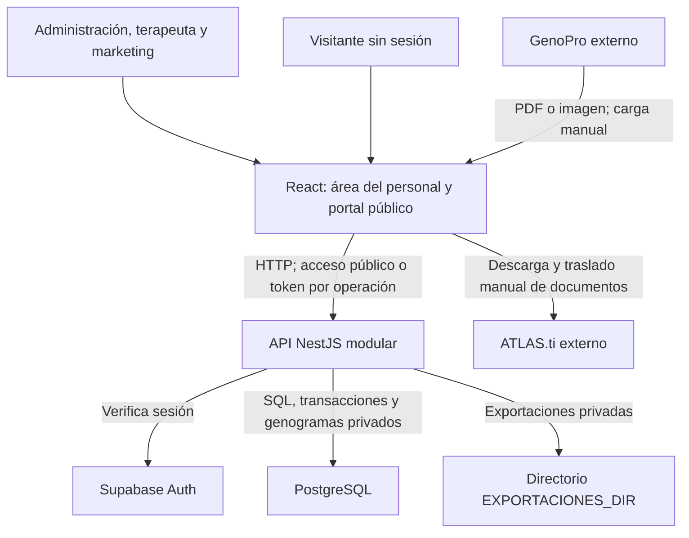

# FE-195 · Arquitectura del incremento integrado

Andrea Carolina Narváez Ortega · 26/11/2026. Base `18ae1cf`, con FE-124, FE-146 y FE-162 de esta entrega. Describe código existente y sus límites; no reemplaza los diagramas históricos de la SRS.

Una misma aplicación React contiene las áreas pública y del personal. La API NestJS aplica autenticación, roles y autorización del caso en cada operación; la navegación del frontend no reemplaza esos controles. Marketing gestiona difusión sin obtener datos clínicos. El portal público consulta contenido publicado mediante controladores separados.

## Correspondencia de componentes

| Módulo en `backend/src` | Responsabilidad integrada | Frontend o evidencia principal |
|---|---|---|
| `modules/auth`, guards comunes | Login, refresh, sesión y logout con timeout de 5 s. | `features/auth`; FE-193 y FE-194. |
| `modules/usuarios` | Cuentas y roles autorizados. | `features/usuarios`. |
| `modules/casos` | Carpeta, residencia, asignación, constancia, familia, ficha vigente, sesiones, tareas, historial y pagos. | `features/carpetas`, `features/expediente`; FE-124 y PR #73. |
| `modules/casos/genograma` | Metadatos y bytes privados por caso, validación y reemplazo. | `genograma-almacen-postgres.ts`: bytes en PostgreSQL; visor `PaginaGenograma`. |
| `modules/indicadores` | Casos actuales y actividad/pagos por período, filtrados por residencia. | `features/indicadores`. |
| `modules/difusion` | Gestión autenticada y lectura pública de campañas, actividades y cursos. | `features/difusion`, `features/publico`; `/fundacion` agrega contenido institucional aprobado. |
| `modules/informes` | Fotografías de origen, borradores sistémicos/judiciales v2 y revisión versionada. | `features/expediente/informes`. |
| `modules/exportaciones` | Selección autorizada, PDF/DOCX y descarga privada. | Directorio `EXPORTACIONES_DIR`; el genograma todavía no se incrusta gráficamente. |
| `modules/importacion` | CSV/XLSX normalizado, revisión, coincidencias, transacción e idempotencia. | `features/importacion`, tabla de FE-162 y asistente de FE-165. |
| `modules/investigacion` | Categorías, selección, revisión con huella y paquete DOCX/TXT. | `features/investigacion`; traslado manual a ATLAS.ti. |
| `database` | Conexión SQL, transacciones y migraciones 001–021. | No se declara migración 021 aplicada a Supabase en esta entrega. |

## Fuentes y límites

- `app.module.ts` determina los módulos cargados. No hay módulo `/api/gastos` ni un módulo integrado de artículos de investigación pública: FE-5 y FE-116 conservan esos pendientes.
- GenoPro no tiene una conexión automática al sistema. Se importa su representación visual; versión/muestra de la instalación siguen pendientes en FE-129.
- ATLAS.ti recibe documentos que la persona autorizada descarga y revisa; no se genera un proyecto nativo ni se certifica la instalación de la Fundación.
- Los genogramas vigentes se almacenan en PostgreSQL; las exportaciones usan archivos privados en disco. Un ensayo de recuperación debe cubrir ambos, no solo el esquema SQL.
- La evaluación inicial se lee desde `fichas_diagnostico` y la vista vigente. Se conserva el alta como antecedente sin rellenar silenciosamente los valores null de la ficha.
- Las fotos/versiones de informes revisados son inmutables. La migración 021 conserva datos e informes existentes.

La [aceptación integrada](../../docs/pruebas/sprint-3/aceptacion-integrada.md) separa aprobación técnica, validación externa y activación del entorno compartido. No se certifican disponibilidad, rendimiento ni RPO/RTO mediante pruebas funcionales.
